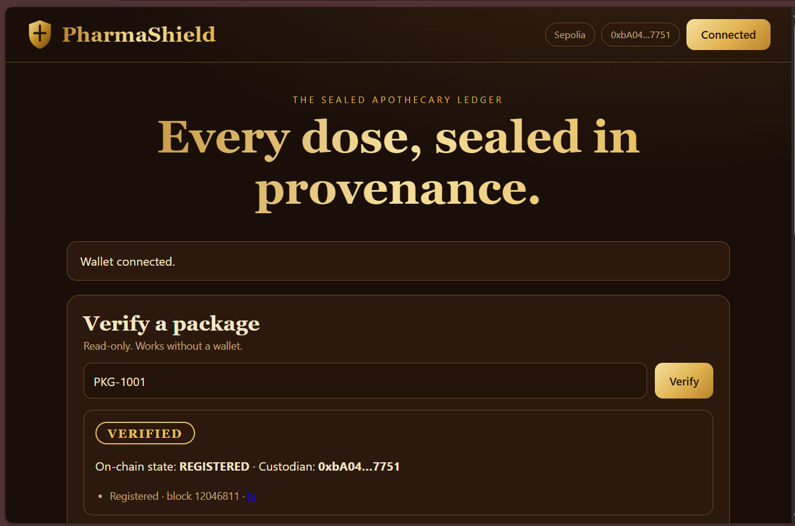
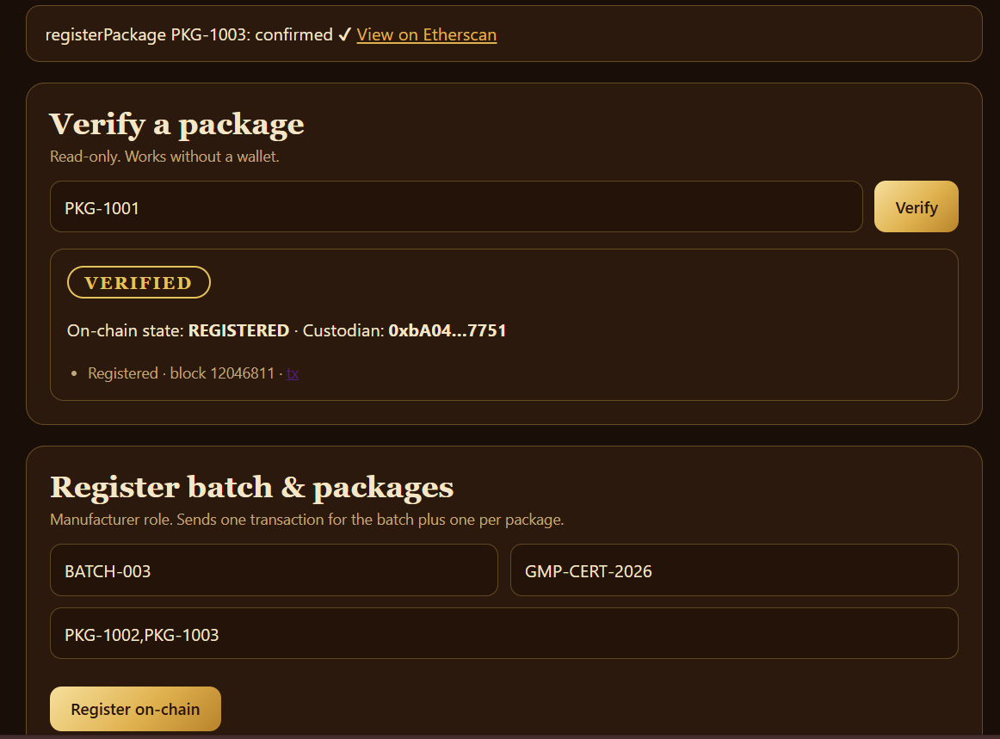
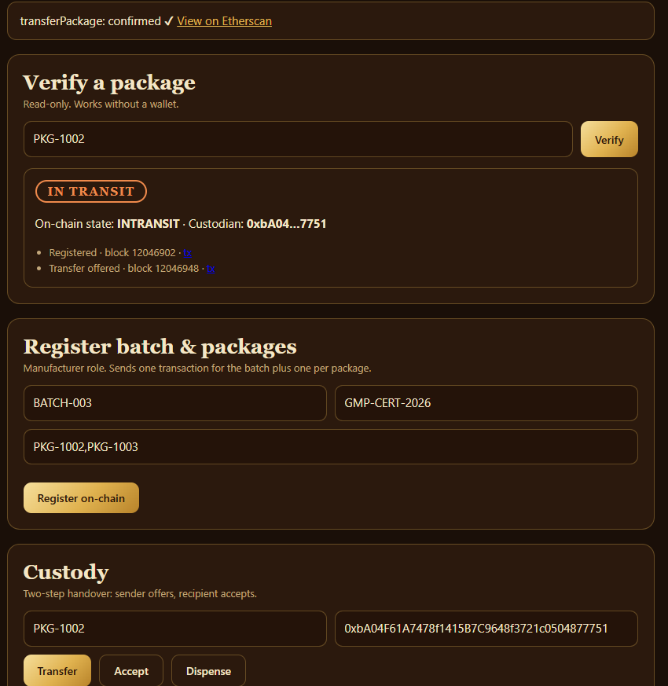
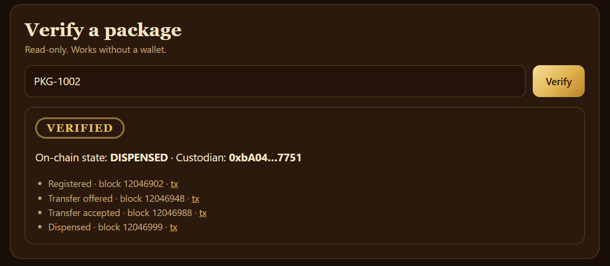
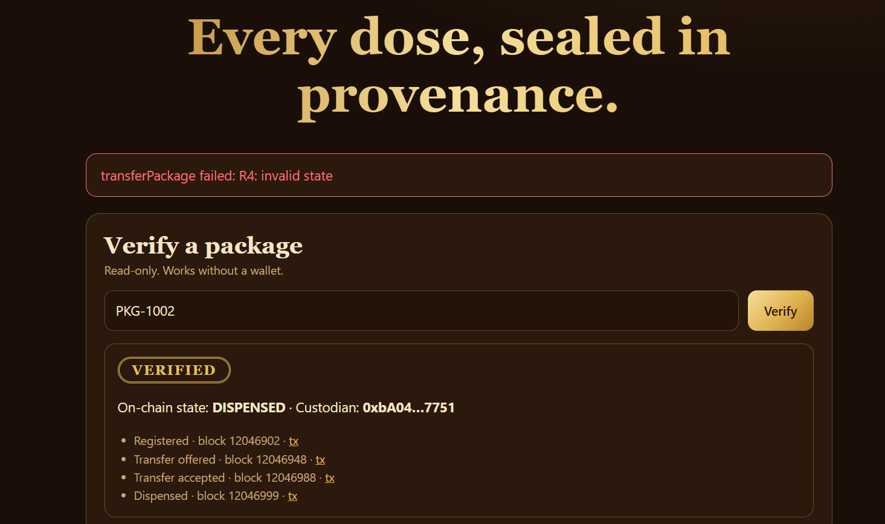
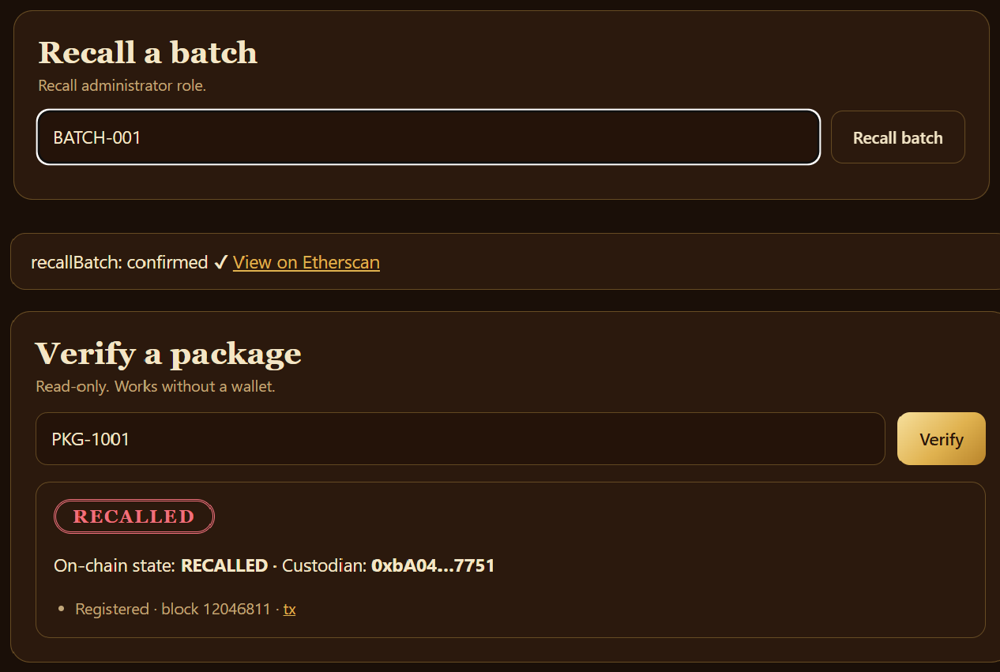

# 🛡️ PharmaShield: Pharmaceutical Package Verification DApp

## Project description
PharmaShield is a decentralized application that records the life of a medicine package on the Ethereum **Sepolia** test network. Manufacturers register batches and unique package IDs, distributors and pharmacies hand packages over in a two-step process, and anyone can verify a package's status without a wallet.

> A blockchain record proves what was registered; it cannot by itself prove that a physical package is genuine. PharmaShield is a prototype that makes unauthorised or invalid actions impossible and visible.

## Features
- Solidity smart contract with role-based access control (OpenZeppelin `AccessControl`): Manufacturer, Distributor, Pharmacy, Recall Admin
- Duplicate package IDs are rejected on-chain
- Two-step custody transfer (offer, then accept) so nobody becomes custodian silently
- Lifecycle states: Registered, InTransit, Received, Dispensed, Recalled, with invalid transitions reverted
- Batch recall that overrides the status of every package in it
- Wallet-connected UI (MetaMask, ethers.js v6) with Sepolia network check and auto-switch
- Public read-only verification with an event-based history and Etherscan links
- Handles rejected signatures, wrong network and reverted transactions
- Hardhat test suite

## Tech stack
Solidity 0.8.24 · Hardhat · OpenZeppelin · ethers.js v6 · HTML/CSS/JavaScript

## Steps to deploy the smart contract
1. Install Node.js 18+ and MetaMask, then get Sepolia test ETH from a faucet.
2. Install dependencies:
   ```bash
   npm install
   ```
3. Copy `.env.example` to `.env` and fill in a **test wallet** private key (never use a real one) and optionally your own RPC URL.
4. Compile and test:
   ```bash
   npx hardhat compile
   npx hardhat test
   ```
5. Deploy to Sepolia:
   ```bash
   npm run deploy:sepolia
   ```
   The script prints the contract address, grants all four roles to the deploying wallet for demo purposes, and writes the address into `frontend/config.js`.

## Steps to run the frontend
```bash
npm run serve
```
Open http://localhost:5173, click **Connect MetaMask**, and make sure the same wallet you deployed with is selected (it holds all roles). The custody demo can be done with a single wallet by entering your own address as the recipient.

## Contract address and network
- **Network:** Sepolia test network (chain ID 11155111)
- **Contract address:** `0x138D8b3c441b10D3b8873f33242ccDbeB723e6De`
- **Etherscan:** https://sepolia.etherscan.io/address/0x138D8b3c441b10D3b8873f33242ccDbeB723e6De

## Screenshots

### Wallet connected 


### package verified


### Custody transfer (In Transit)


### Package dispensed with full history


### Security rule blocks an invalid transfer


### Batch recalled


## Project structure
```
contracts/PharmaShield.sol   smart contract
scripts/deploy.js            deploy + role setup
test/PharmaShield.test.js    Hardhat tests
frontend/                    index.html, app.js, style.css, config.js
screenshots/                 UI screenshots
```

## Author
Amina S · MSc Computer Science (Cyber Security), Digital University Kerala.